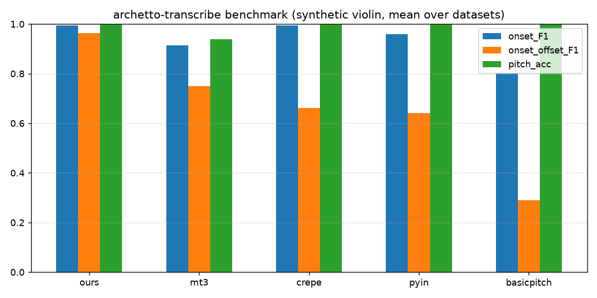

# archetto-transcribe

**Violin-oriented music transcription engine** extracted from [Archetto](https://archetto-mocha.vercel.app), Pascal Gautier's
practice platform: isolate an instrument from a mix, transcribe it for violin, practise with the backing track.

> Status: **0.1.0.dev0, early public release.** The code is the Archetto pipeline (`archetto_transcribe/pipeline.py`)
> vendored as-is with a small engine API on top; it will be split into modules before a public release.

## What it does

```
audio ─▶ separation (Demucs htdemucs_6s, optional 2nd pass) ─▶ note engine ─▶ cleanup ─▶ grid & priors ─▶ MusicXML / MIDI / PDF
                                                 │                   │                │
                       basicpitch | crepe | pyin | mt3 | ours    held-note merging   beat map, key plan (modulations),
                                                                 double stops,       motifs, style priors (tango figures),
                                                                 octave errors       N-voice split (duo/trio), voice roles
                                                                                     (e.g. Vl. II steady eighths, Vl. III offbeats)
                                                                 learning from corrections ─▶ profiles/<style>.json
```

* **Engines** (`--transcripteur` / `engine=`): `basicpitch` (Spotify, polyphonic), `crepe` (torchcrepe f0 + onset segmentation),
  `pyin` (librosa), `mt3` (Magenta, run in its own JAX environment), and **`ours`** = CREPE f0 segmented at audio onsets +
  Archetto's held-note merging / parasite-note cleanup.
* **Style priors**: tango accompaniment figures (eighth rest + 3 sixteenths, 4-sixteenth pickups, offbeats), checked against audio onsets.
* **Voice roles**: in multi-violin passages, impose a rhythmic role per voice (steady eighths, offbeats) and report where it fits the audio.
* **Learning from corrections**: `python -m archetto_transcribe learn original.musicxml corrected.musicxml --style tango`
  classifies corrections bar by bar and tunes the style profile used by the next runs.

## Quick start

```bash
pip install -e ".[all]"            # Basic Pitch, torch + torchcrepe, Demucs
python -m archetto_transcribe notes violin.wav --engine ours > notes.json
python -m archetto_transcribe song.wav --style tango --transcripteur crepe --out out/   # full pipeline (MuseScore for PDF: env MSCORE)
```
MT3 (optional): Python 3.12 venv in `mt3/.v` with `jax[cpu]` + `git+https://github.com/magenta/mt3`, a clone of the repo in `mt3/src`
(gin files) and the `checkpoints/mt3` folder from the public `gs://mt3` bucket in `mt3/ckpt/`; see `mt3/infer_mt3.py`.

## Benchmark

`python benchmark/run.py` — every engine on every dataset of `benchmark/data/`, metrics with **mir_eval**:
note onset F1 (±50 ms), onset+offset F1 (mir_eval default: offset within 20 % of the note or 50 ms), note F1 without offset,
pitch accuracy of onset-matched notes (±½ semitone), fragmentation (extra notes starting inside a reference note, per reference note).
Datasets and their licenses: [`benchmark/DATASETS.md`](benchmark/DATASETS.md). Synthetic ground truth: `benchmark/synth.py`.

Current leaderboard (synthetic violin, 4 lines, 978 notes; mean over datasets):

| rank | engine | note onset F1 | onset+offset F1 | note F1 (no offset) | pitch acc. | fragmentation ↓ |
|---|---|---|---|---|---|---|
| 1 | ours | 0.994 | 0.964 | 0.992 | 0.998 | 0.006 |
| 2 | mt3 | 0.913 | 0.750 | 0.862 | 0.938 | 0.027 |
| 3 | crepe | 0.994 | 0.661 | 0.994 | 1.000 | 0.006 |
| 4 | pyin | 0.960 | 0.641 | 0.960 | 1.000 | 0.009 |
| 5 | basicpitch | 0.804 | 0.291 | 0.804 | 1.000 | 0.067 |



**Caveats (read before quoting):** the ground truth is synthetic (clean additive violin, no backing, no separation artefacts) and was rendered from scores our own pipeline produced; `ours` offset threshold (10 dB drop) was tuned on this same set, so its offset score is optimistic. On real separated stems the ranking of onset accuracy is different (see real-audio report). A human-corrected real-audio set is the next step.

Real-audio comparison (no exact ground truth; attacks vs detected audio onsets, same post-processing): [`results/real_audio.md`](results/real_audio.md).

## License

Proposed: **Apache-2.0** (patent grant, same license as Basic Pitch and MT3; compatible with the MIT/ISC/BSD dependencies).
MIT would also work. See `LICENSE` and `NOTICE`.

---

## Résumé en français

**archetto-transcribe** est le moteur de transcription d'Archetto, rendu indépendant : séparation (Demucs), moteur de notes au choix
(Basic Pitch, CREPE, pYIN, MT3 ou le nôtre — CREPE + segmentation aux attaques + fusion des notes tenues), puis la chaîne Archetto :
carte des temps, plan tonal, motifs, a priori de style (figures du tango), séparation en 2–3 violons, rôles rythmiques des voix,
et apprentissage à partir des corrections de Pascal. Un banc d'essai reproductible (mir_eval) compare les moteurs ; le tableau
ci-dessus est le classement actuel. Statut : brouillon local, **pas encore publié** — en attente de la validation de Pascal
(licence proposée : Apache-2.0).
